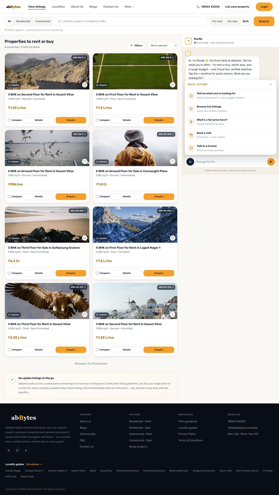
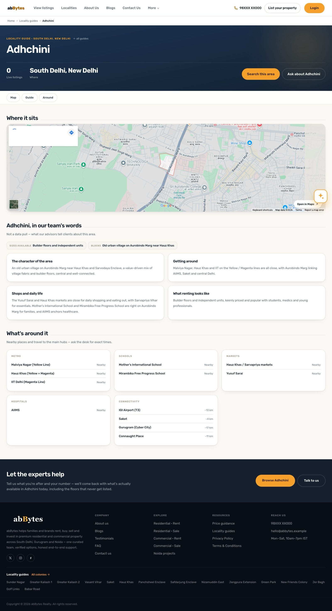
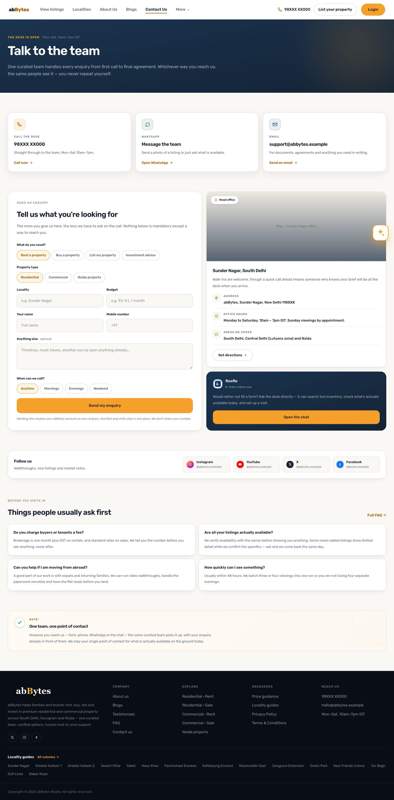
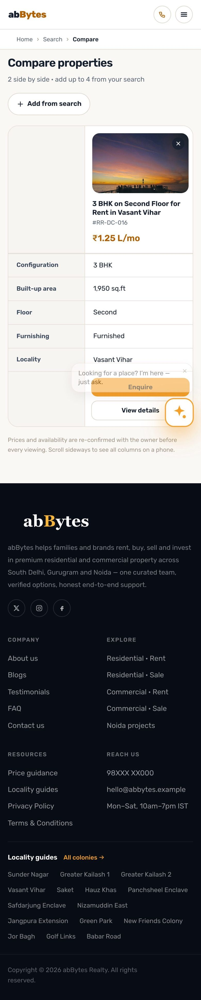

# Real Estate Platform — public website

**Status:** live since the 9 Sep 2026 relaunch. Live site: [rentaroof.in](https://rentaroof.in).
**My role:** requirements, product decisions and an AI-assisted build: AI coding agents write the code under my direction, and I test every change. It is the public side of the [Real Estate Platform — CRM & operations](https://github.com/abBytes-sudo/real-estate-crm-showcase).

**Results**
- 6,843 active listings published straight from CRM inventory (22 Oct 2026).
- Rent searches for 5 key South Delhi localities showed rentaroof.in on Google's first page within 30 days of the Sep 2026 relaunch (Search Console and manual checks).
- Roofie, the site's enquiry assistant, answered 42 of 47 website chats with no agent reply (5 Oct 2026). Roofie is scripted (rule-based), not AI.

Screenshots are from a demo build: "abBytes" is a placeholder brand standing in for Rent A Roof, and the listings, stock photos (any faces blurred), phone numbers (masked) and emails are placeholders. Layouts match production.

*Source is in a private repo; walkthrough on request.*

---

## What it is

Rent A Roof is a South Delhi property-consultation company. The website is the public side of the same Laravel app as the CRM. It publishes straight from CRM inventory, with no sync step:

- **Home** — hero search, featured listings, locality entry points and the Roofie enquiry assistant.
- **Listings & search** — plain-English search over live inventory, with filters, verified badges and photo galleries.
- **Property detail** — spec sheet, photo gallery, "verified by us" details, neighbourhood context (metro, schools, connectivity), similar listings, the locality guide and an enquiry path.
- **Compare & shortlists** — up to four listings side by side; saved shortlists.
- **Locality guides & price guide** — colony pages with price bands and live listings.
- **Roofie** — a scripted (rule-based) enquiry assistant, not AI: quick actions to start a requirement, browse listings, check price bands, book a visit or reach a person.
- **Testimonials, About, Contact, List-your-property** — the trust and supply pages.
- **Customer area** — phone-OTP sign-in to a shortlist dashboard.
- **SEO** — locality and colony landing pages; about 7,700 sitemap URLs (5 Oct 2026).

Design: Tailwind v4 `@theme` tokens (Rubik + IBM Plex Mono; warm cream / navy ink / amber), no CDNs, mobile-first.

---

## Screenshots · *demo build (placeholder brand, fictional data)*

### Listings & property detail
**Listings** — search results with filters, compare tick-boxes and the Roofie quick-actions panel

**Property detail** — spec sheet, gallery, neighbourhood, similar listings, locality guide

**Compare** — up to four listings side by side

### Locality guides
**Localities index** (top of the page; [full page](screenshots/d-localities.jpg))

**Locality guide**

### Contact

### Mobile
| Listings | Property | Localities |
|---|---|---|
|  |  |  |

| Locality guide | Contact | Compare |
|---|---|---|
|  |  |  |

---

## How it was built
AI-assisted delivery: I set the requirements and product decisions, directed AI coding agents through the build and tested every change. Earlier versions of the Rent A Roof website were built by outside teams that I coordinated.

## Tech
Laravel 13 · Blade · Alpine.js · Tailwind CSS v4 (`@theme` tokens) · MySQL (shared with the CRM) · PHP 8.4 · phone-OTP customer area

---
Developed (AI-assisted) by **[@abBytes-sudo](https://github.com/abBytes-sudo)** for Rent A Roof · [LinkedIn](https://www.linkedin.com/in/abhishek-m-b934a925a)

© 2026 [@abBytes-sudo](https://github.com/abBytes-sudo). Write-up and screenshots shared for portfolio review; not licensed for reuse.
